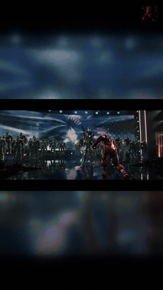

<p align="center">
  
</p>

<p align="center">
  
  
  
  
  
</p>

**Grimframe** turns a comic-book idea into a finished vertical Short: it scouts a story worth telling,
downloads the issue, finds every panel, writes a fact-grounded script, voices it, and renders a
9:16 video with music, ready for captions in CapCut. A desktop/LAN UI walks each stage; every stage also runs from the CLI.

---

## Finished output demo

[](assets/readme/demo.mp4)

**[Watch the MP4 with audio](assets/readme/demo.mp4)** — a 15.7-second excerpt from
Iron Man #11, rendered with the default Machiavelli voice. The excerpt ends at a
complete sentence; captions can be added later in CapCut.

## How it works

<p align="center">
  
</p>

| Stage | What happens | Where |
|---|---|---|
| **1 · Scout** | Finds a story or a Q&A question with the You.com Research API, verifies the exact issue, checks evidence with an OpenRouter gate, and skips anything already made (done-ledger). | `stages/stage_1/`, `stages/research_scout/`, `stages/youcom_scout.py` |
| **2 · Panels** | Downloads the issue pages, detects panels with Magi, reads dialog (OCR) and describes panels with a VLM. | `stages/stage_2/` |
| **3 · Script** | Splits the story into beats and writes the narration for the chosen format, grounded on the beats' page/panel refs. | `stages/stage_3/` |
| **✓ · Review** | Master hand-picks the panel (or a custom image / clip) for every beat before anything renders. | `stages/review_gate.py`, `ui/screens/s_review_gate.py` |
| **4 · Voice** | Synthesizes the narration — local Chatterbox voice clone by default, Cartesia or Resemble on request — and times every beat. Narration is saved in spoken form (`issue fifteen`, never `#15`) so the voice never trips on digits or symbols. | `stages/stage_4/` |
| **5 · Render** | Builds Ken Burns shots per beat, optional video clips, music bed / CapCut music sync, and writes `final.mp4`. No burned-in captions — those are added later in CapCut. | `stages/stage_5/`, `stages/music_sync.py` |
| **+ · Mascot** | Optional last step (UI step 9): places the Rook sticker narrator on a still preview, cues its poses and moves on a timeline, and redraws `final.mp4` from a kept clean copy. | `stages/mascot/`, `ui/screens/s9_mascot.py` |

## Formats

<p align="center">
  
</p>

| Format | Shape | Typical length |
|---|---|---|
| **Recap** | One issue told from start to end | 60–76 s |
| **Micro moment** | One scene: setup → turn → how it ends | 30–50 s |
| **Q&A** (`explore_answer`) | "Every time X…" — one answer per comic issue, cited | main format |
| **Panel walk** | Literal panel-by-panel narration at long-form pace | long-form |
| **Screen Q&A** (`screen_qa`) | Film / TV canon, cited by title and year | agent-first orchestrator |

## Quick start

**Requirements:** Python 3.13, `ffmpeg` on `PATH` (`brew install ffmpeg` on macOS).

```bash
python -m venv .venv && source .venv/bin/activate      # Windows: .venv\Scripts\activate
pip install -r requirements.txt
```

Create a `.env` in the repo root with the keys you need:

| Key | Used for |
|---|---|
| `OPENROUTER_API_KEY` | Script writing, research planner, evidence gate |
| `YDC_API_KEY` | You.com research (scout) |
| `CARTESIA_API_KEY` / `RESEMBLE_API_KEY` | Hosted TTS (optional; set `TTS_PROVIDER`) |
| `COMIC_VINE_API_KEY` | Issue cross-check (optional) |

### Default narration voice

Local Chatterbox uses the bundled `assets/voices/machiavelli_ref.wav` reference
(approved 2026-11-10). Default delivery: exaggeration `0.35`, CFG weight `0.5`,
temperature `0.7`. The same voice is used by Stage 4 and background beat TTS.
No voice training or hosted TTS account is needed; the isolated `.venv-chatterbox`
runtime and its model weights must be installed on the machine.

`CHATTERBOX_VOICE_WAV` overrides the default reference. A Stage 4 `--voice` file
path overrides it for one run. The matching environment settings are
`CHATTERBOX_EXAGGERATION`, `CHATTERBOX_CFG_WEIGHT`, and `CHATTERBOX_TEMPERATURE`.
Existing rendered audio is preserved; use Stage 4 `--force` to regenerate an old
project with this voice, then rerun Stage 5 to update its video timing.

### Run the UI

```bash
python -m ui            # http://localhost:8550
python -m ui --lan      # reachable from other machines on the network
```

On the Windows server, `run_ui.bat` / `run_ui_lan.bat` start the same UI from `.venv`.

### Run stages from the CLI

```bash
python -m stages.stage_1 "The death of Gwen Stacy"     # identify / research
python -m stages.stage_2 --project <slug> --url <url>  # download + panels
python -m stages.stage_3 --project <slug>              # script
python -m stages.stage_4 --project <slug>              # voice
python -m stages.stage_5 --project <slug>              # render → projects/<slug>/final.mp4

python -m stages.answer_pipeline --project <slug> --question "…"   # Q&A end to end
python -m stages.screen_pipeline --project <slug> --question "…"   # Screen Q&A end to end
python -m stages.youcom_scout micro                                # scout micro moments
```

### Tests

```bash
python -m pytest -q
```

## Documentation

Browse the [documentation index](docs/README.md) for guides and architecture contracts,
or the [archive](docs/archive/README.md) for past research, audits, and handoffs.

## Project layout

```
comic-book-pipeline/
├── config.py               # every knob, read from .env
├── stages/
│   ├── stage_1/            # identify + research agent
│   ├── research_scout/     # You.com scout, planner, evidence gate, done-ledger
│   ├── stage_2/            # download, Magi panel detection, OCR/VLM
│   ├── stage_3/            # beats + narration per format
│   ├── stage_4/            # TTS (Chatterbox / Cartesia / Resemble) + beat timing
│   ├── stage_5/            # shots, clips, audio mix, final render
│   ├── review_gate.py      # per-beat panel locks
│   └── music_sync.py       # CapCut reference-track beat sync
├── ui/                     # Flet app (screens per stage, review gate)
├── prompts/ research_prompts/ research_policies/   # LLM + scout prompts and policies
├── art_pipeline/ art_ui/   # sister pipeline for art-history videos
├── assets/                 # branding, music beds, README graphics
├── scripts/                # maintenance (ledger export/backup, acceptance runs)
├── tests/                  # pytest suite
├── docs/                   # guides, architecture contracts, archived research
└── projects/               # one folder per video (git-ignored)
```

<sub>README graphics are animated SVGs in <code>assets/readme/</code>; they respect <code>prefers-reduced-motion</code>.</sub>

<!-- last sync: 2026-11-10 -->
